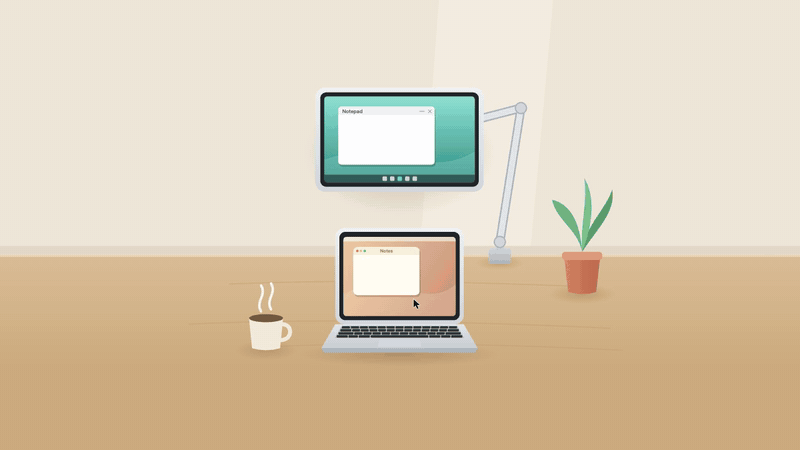
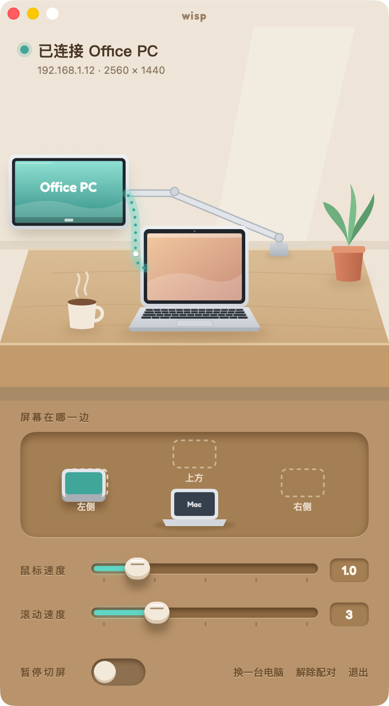
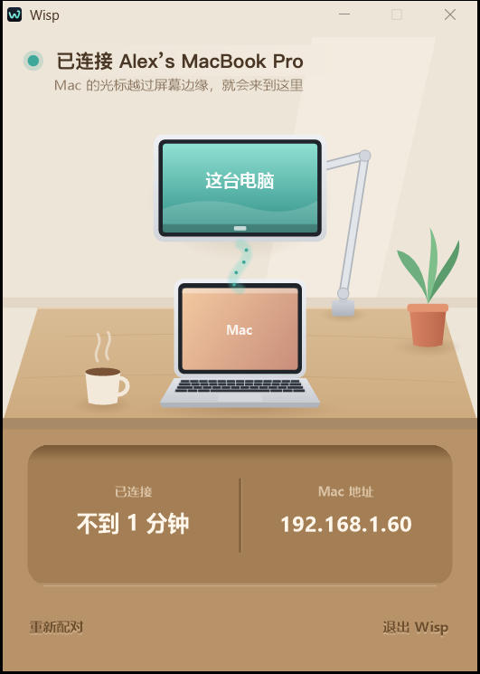

<div align="center">

**English** · [中文](README.zh-CN.md)

# Wisp

Use your Mac's trackpad and keyboard on a Windows PC.



</div>

## Features

- **Edge switching**: move the cursor past the edge of the Mac's screen to control Windows; the other screen can be above, left or right of the Mac
- **Keyboard mapping**: keys map by physical position, ⌘ becomes Ctrl, pinch-to-zoom becomes Ctrl + scroll; held keys are released when you switch
- **Clipboard sync**: plain text both ways, up to 1 MB, skipping anything a password manager marks as sensitive
- **Pairing and encryption**: automatic discovery on the local network, pairing with a 6-digit code (SPAKE2), traffic encrypted with ChaCha20-Poly1305
- **Lightweight**: about 3 MB of memory on the Mac and 2 MB on Windows; written in Rust, no runtime
- **Failsafe**: if the background process stalls for more than 1.5 s, a watchdog hands the keyboard and mouse back to the Mac

<table>
<tr>
<td align="center" width="50%"><br><sub>Mac settings</sub></td>
<td align="center" width="50%"><br><sub>Windows status</sub></td>
</tr>
</table>

The interface is currently in Chinese.

## Install

Download from [Releases](https://github.com/xfun-dev/wisp/releases/latest).

**Mac** (macOS 14+, Apple silicon and Intel)
1. Open `Wisp-<version>.dmg` and drag Wisp into Applications
2. Open Wisp. If macOS says it can't verify the developer, click "Open Anyway" in System Settings → Privacy & Security
3. Allow `wisp` in System Settings → Privacy & Security → Accessibility

**Windows** (Windows 10/11)
1. Double-click `Wisp-<version>.exe`; it installs itself and opens the status window

**Pairing**: in Wisp on the Mac, click "配对新电脑" (pair a new computer) and type the 6 digits into the Windows status window. Once paired, the two connect on their own at startup.

To uninstall: on the Mac, choose "卸载 Wisp…" (Uninstall Wisp) from the Wisp menu; on Windows, uninstall it from Settings → Apps.

## Build from source

Requires [Rust](https://rustup.rs), the Xcode command line tools and mingw-w64 (`brew install mingw-w64`).

```sh
scripts/verify.sh     # tests, and builds the Mac, Windows and settings-window binaries
scripts/release.sh    # makes dist/Wisp-<version>.dmg and dist/Wisp-<version>.exe
```

The behaviour spec is [RULES.md](RULES.md) (in Chinese); every rule names the test that covers it.

### Developer bridge (development builds only)

Builds made with `--features bridge` (as `scripts/deploy.sh` does) carry a developer bridge: the paired Mac can run commands and move files on the Windows PC over the existing encrypted link, so deploying and testing need no other remote tool.

It is made mainly for AI assistants: an AI working on the Mac (Claude Code, for example) can use it to operate the Windows PC directly and do anything that needs doing there.

- Turn it on: in the Mac settings window, click the plant twice and then the mug (or run `wisp win on`); the same again turns it off, and it closes by itself after 8 hours
- While it is on, both sides show it: the steam over the Mac's mug turns teal, and both windows say the bridge is open and for how long
- Use: `wisp win exec "<command>" [--timeout seconds]`, `wisp win put <local> <remote>`, `wisp win get <remote> <local>`

The installers in Releases do not include it; `scripts/release.sh` checks the binaries and refuses to package a build that does.

## License

[MIT](LICENSE). The Fredoka font used by the settings window is under the [SIL Open Font License](ui/mac/fonts/Fredoka-OFL.txt).
