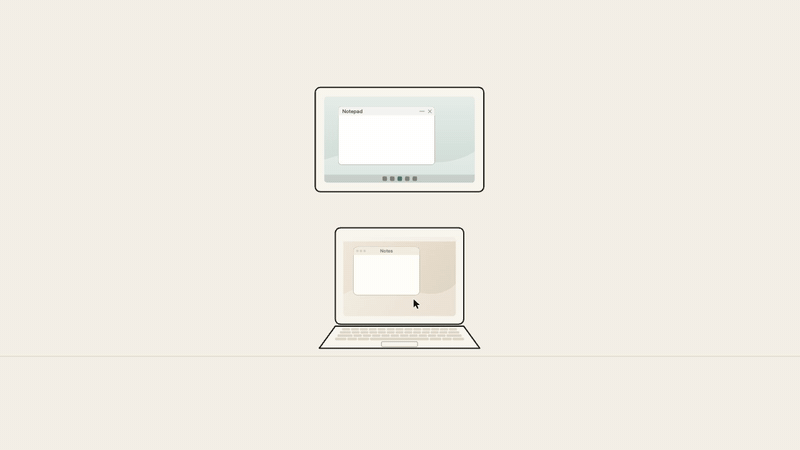
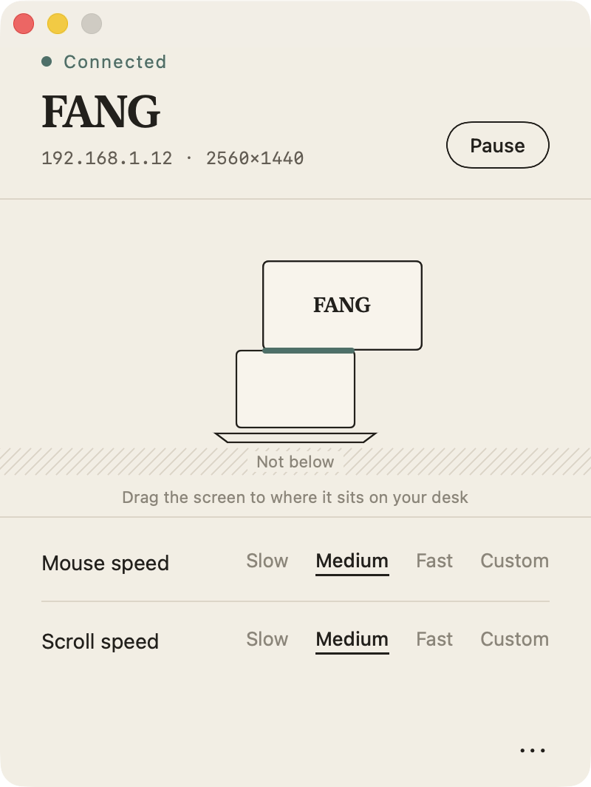
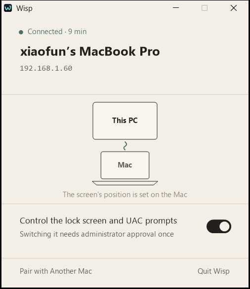

<div align="center">

**English** · [中文](README.zh-CN.md)

# Wisp

Use your Mac's trackpad and keyboard on a Windows PC.



</div>

## Features

- **Edge switching**: move the cursor past the edge of the Mac's screen to control Windows; the other screen can be above, left or right of the Mac
- **Keyboard mapping**: keys map by physical position, ⌘ becomes Ctrl, pinch-to-zoom becomes Ctrl + scroll; the volume and playback keys on the top row work on Windows as usual, and Mission Control and Spotlight open Windows' Task View and Search; held keys are released when you switch
- **Clipboard sync**: plain text both ways, up to 1 MB, skipping anything a password manager marks as sensitive
- **Pairing and encryption**: automatic discovery on the local network, pairing with a 6-digit code (SPAKE2), traffic encrypted with ChaCha20-Poly1305
- **Lightweight**: about 3 MB of memory on the Mac and 2 MB on Windows; written in Rust, no runtime
- **Lock screen and UAC prompts**: turn on the switch in the Windows status window or tray menu and approve it once; after that the Windows lock screen, sign-in screen and UAC prompts take input from the Mac too, so the PC needs no keyboard or mouse of its own
- **Says why it can't connect**: when the PC can't be found, the Mac window shows how long it has been looking, what it checked and why the last connection ended; both windows follow light and dark mode
- **Languages**: the interface follows the system language: English, Simplified and Traditional Chinese, Japanese, Korean
- **Failsafe**: if the background process stalls for more than 1.5 s, a watchdog hands the keyboard and mouse back to the Mac

<table>
<tr>
<td align="center" width="50%"><br><sub>Mac settings</sub></td>
<td align="center" width="50%"><br><sub>Windows status</sub></td>
</tr>
</table>

## Install

Download from [Releases](https://github.com/xfun-dev/wisp/releases/latest). The plain build is all you need for sharing the keyboard and trackpad; for the [developer bridge](#developer-bridge-developer-builds), download the `-dev` build on both computers.

**Mac** (macOS 14+, Apple silicon and Intel)
1. Open `Wisp-<version>.dmg` and drag Wisp into Applications
2. Open Wisp. If macOS says it can't verify the developer, click "Open Anyway" in System Settings → Privacy & Security (Wisp is not code-signed)
3. Allow `wisp` in System Settings → Privacy & Security → Accessibility

**Windows** (Windows 10/11)
1. Double-click `Wisp-<version>.exe`; it installs itself and opens the status window. If "Windows protected your PC" appears, click "More info" → "Run anyway" (Wisp is not code-signed)

**Pairing**: in Wisp on the Mac, click "Pair New Computer" and type the 6 digits into the Windows status window. Once paired, the two connect on their own at startup.

To uninstall: on the Mac, choose "Uninstall Wisp…" from the Wisp menu; on Windows, uninstall it from Settings → Apps.

## Build from source

Requires [Rust](https://rustup.rs), the Xcode command line tools and mingw-w64 (`brew install mingw-w64`).

```sh
scripts/verify.sh     # tests, and builds the Mac, Windows and settings-window binaries
scripts/release.sh    # makes dist/Wisp-<version>.dmg and dist/Wisp-<version>.exe
```

The behaviour spec is [RULES.md](RULES.md) (in Chinese); every rule names the test that covers it.

### Developer bridge (developer builds)

Developer builds carry a developer bridge; they are built with `--features bridge`, as `scripts/deploy.sh` does. The paired Mac can run commands and move files on the Windows PC over the existing encrypted link, so deploying and testing need no other remote tool.

The bridge is mainly for AI coding assistants on the Mac. Claude Code, for example, can use it to build, run tests and read logs on Windows.

- Turn it on: in the Mac settings window, switch on Developer Bridge in the ··· menu (or run `wisp win on`); switch it off the same way. It stays on until you turn it off, across restarts and reconnects
- While it is on, both windows say the bridge is open
- Use: `wisp win exec "<command>" [--timeout seconds]`, `wisp win put <local> <remote>`, `wisp win get <remote> <local>`

In Releases, the files ending in `-dev` are the developer builds with the bridge; the plain ones do not have it. Both computers need the developer build.

## License

[MIT](LICENSE).
