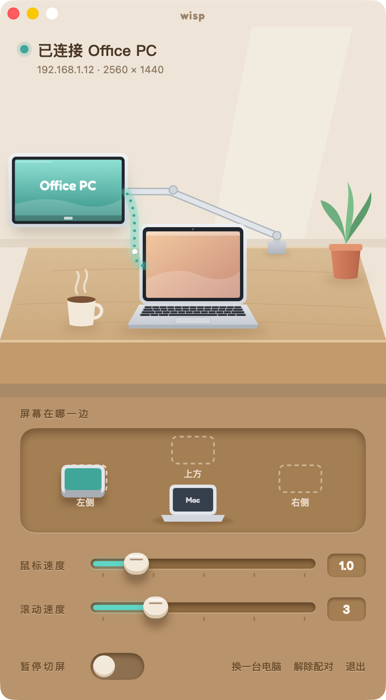
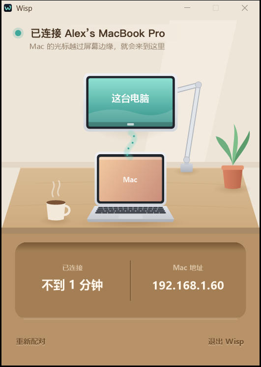

<div align="center">

[English](README.md) · **中文**

# 一缕 Wisp

用 Mac 的触控板和键盘操作 Windows 电脑。


</div>

## 特性

- **边缘切换**：光标越过 Mac 屏幕边缘即进入 Windows，支持屏幕在上方、左侧、右侧三种布局
- **键盘映射**：按物理位置映射按键，⌘ 对应 Ctrl，双指缩放对应 Ctrl + 滚轮；顶排的音量、播放、调度中心、聚焦搜索键在 Windows 上同样可用；切换时自动松开按住的键
- **剪贴板同步**：双向同步纯文本，最大 1 MB，跳过密码管理器标记为敏感的内容
- **配对与加密**：局域网自动发现，6 位配对码配对（SPAKE2），传输使用 ChaCha20-Poly1305 加密
- **低占用**：常驻内存 Mac 约 3 MB、Windows 约 2 MB，Rust 编写，无运行时
- **锁屏和权限弹窗**：可在托盘菜单开启（需管理员授权一次），之后 Windows 的锁屏、登录界面和 UAC 弹窗也能用 Mac 操作，不再需要 Windows 自己的键鼠
- **故障保护**：后台卡顿超过 1.5 秒时，看门狗自动把键鼠交还给 Mac

<table>
<tr>
<td align="center" width="50%"><br><sub>Mac 设置窗口</sub></td>
<td align="center" width="50%"><br><sub>Windows 状态窗口</sub></td>
</tr>
</table>

## 安装

从 [Releases](https://github.com/xfun-dev/wisp/releases/latest) 下载。普通版即可满足键鼠共享；需要[开发者通道](#开发者通道开发者版)的话，两台电脑都下载文件名带 `-dev` 的开发者版。

**Mac**（macOS 14+，Apple 芯片和 Intel）
1. 打开 `Wisp-<版本>.dmg`，把 Wisp 拖进"应用程序"
2. 打开 Wisp。如提示无法验证开发者，在"系统设置 → 隐私与安全性"中点"仍要打开"
3. 在"系统设置 → 隐私与安全性 → 辅助功能"中允许 `wisp`

**Windows**（Windows 10/11）
1. 双击 `Wisp-<版本>.exe`，自动安装并打开状态窗口

**配对**：在 Mac 的 Wisp 中点"配对新电脑"，把显示的 6 位数字填入 Windows 的状态窗口。配对后两台电脑开机自动连接。

卸载：Mac 上在 Wisp 菜单中选择"卸载 Wisp…"；Windows 上在"设置 → 应用"中卸载。

## 从源码构建

需要 [Rust](https://rustup.rs)、Xcode 命令行工具和 mingw-w64（`brew install mingw-w64`）。

```sh
scripts/verify.sh     # 测试，并编译 Mac 版、Windows 版和设置窗口
scripts/release.sh    # 生成 dist/Wisp-<版本>.dmg 和 dist/Wisp-<版本>.exe
```

行为规格见 [RULES.md](RULES.md)，每条规则都注明了对应的测试。

### 开发者通道（开发者版）

用 `--features bridge` 编译（`scripts/deploy.sh` 默认如此）的版本带一条开发者通道：已配对的 Mac 可以通过现有的加密连接在 Windows 上执行命令、收发文件，部署和测试不需要额外的远程工具。

它主要是为 AI 助手准备的：在 Mac 上工作的 AI（例如 Claude Code）可以通过它直接操作这台 Windows 电脑，完成任何需要在 Windows 上做的事。

- 开启：在 Mac 设置窗口中点两下花盆、再点一下茶杯（或 `wisp win on`）；同样操作关闭。不会自动关闭，重启或重连后保持原样
- 开启期间两端都有提示：Mac 茶杯的热气变为青色，两边窗口都显示"开发者通道已开启"
- 使用：`wisp win exec "<命令>" [--timeout 秒]`、`wisp win put <本地> <远程>`、`wisp win get <远程> <本地>`

Releases 中文件名带 `-dev` 的是开发者版，带此功能；不带 `-dev` 的普通版不含。需要两台电脑都装开发者版。

## 许可

[MIT](LICENSE)。设置窗口使用的 Fredoka 字体遵循 [SIL Open Font License](ui/mac/fonts/Fredoka-OFL.txt)。
